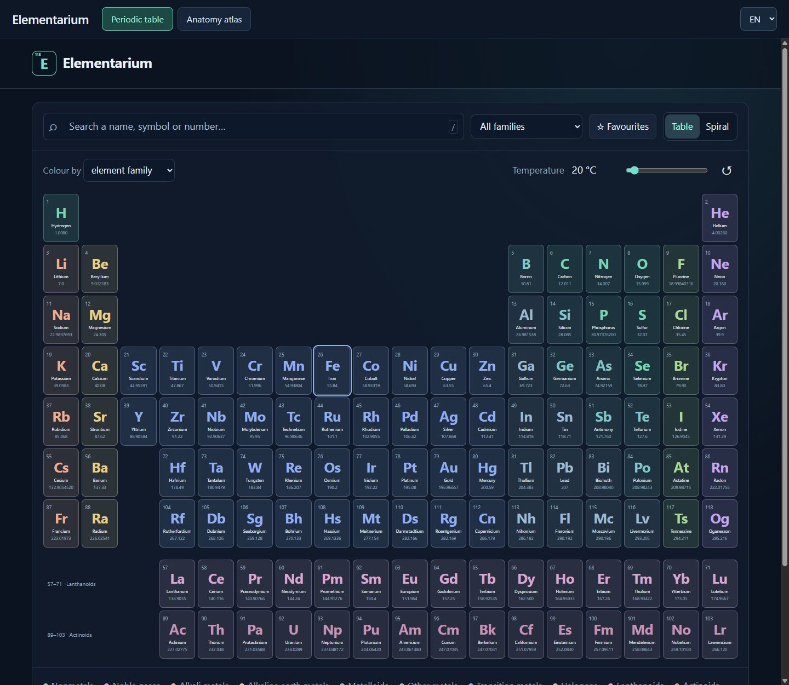
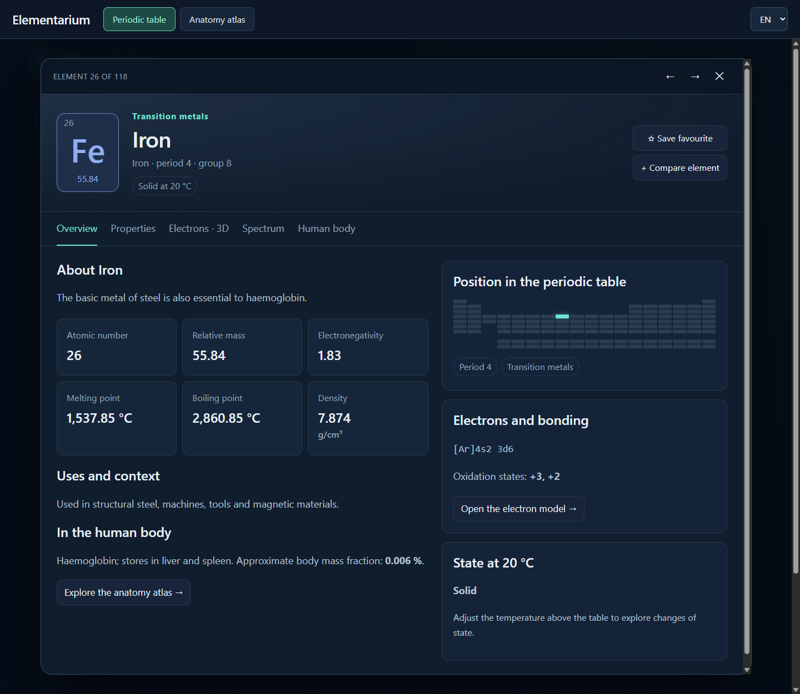
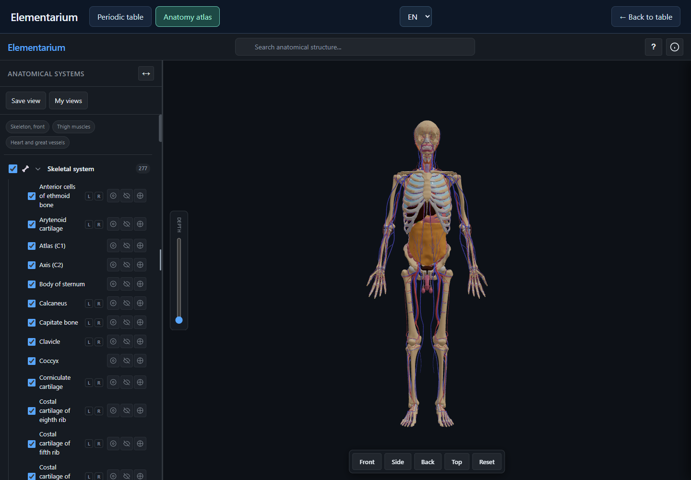
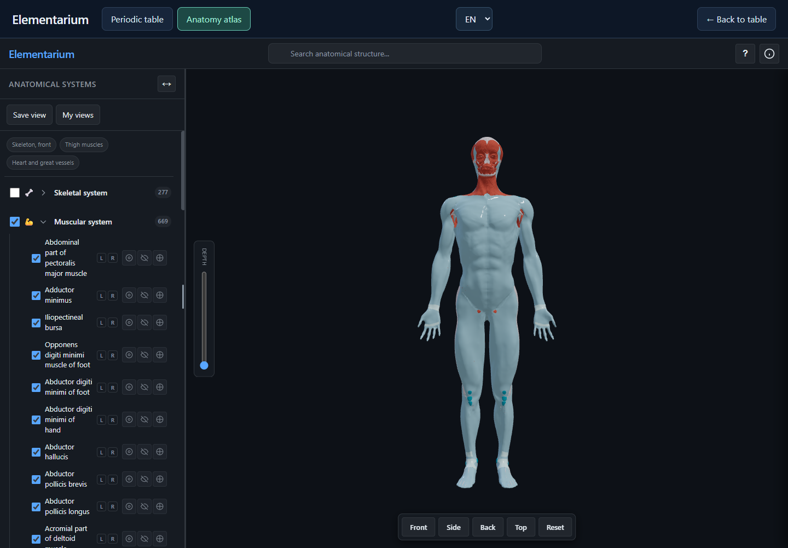
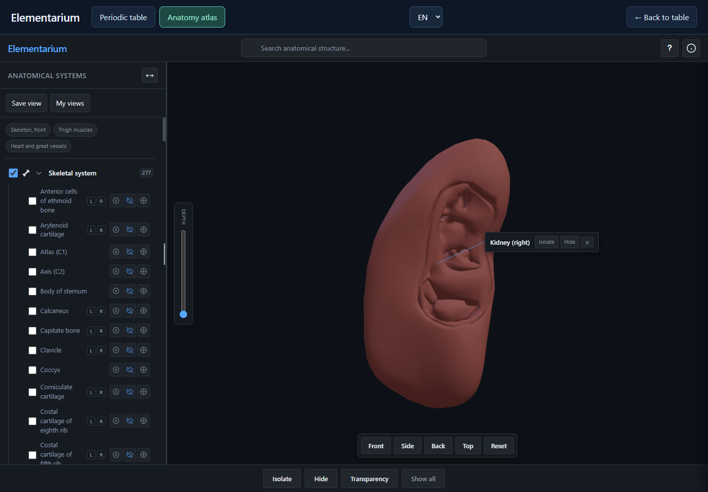
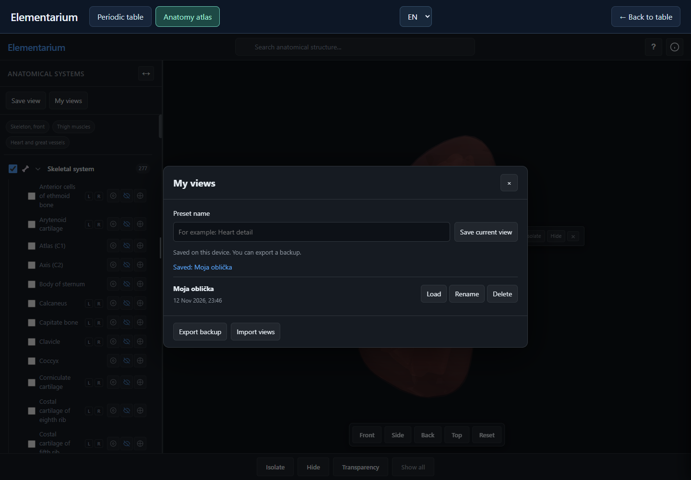

# Elementarium

**An offline interactive periodic table and 3D human anatomy atlas for Windows, Linux and web browsers.**

Explore all **118 chemical elements**, visualize atomic structures and discover **2,827 anatomical objects** across seven body systems — all in one application.

Elementarium is designed for education, exploration and independent learning. All essential content, 3D models and resources are bundled for offline use.

## Features

### Interactive Periodic Table
- All 118 chemical elements with detailed properties.
- Interactive electron models and atomic structure visualization.
- Element comparisons and light frequency calculations.
- Integrated chemistry and human anatomy exploration.

### 3D Human Anatomy
- **2,827 selectable anatomical objects** across seven systems:
  - Skeletal (277)
  - Joints (349)
  - Muscular (669)
  - Cardiovascular (676)
  - Lymphatic (158)
  - Nervous (580)
  - Visceral (118)
- Rotate, zoom, isolate and explore individual structures.
- Adjust visibility, transparency and depth.
- Automatically center selected anatomical structures.
- Save, restore and manage custom 3D views.
- Import and export saved views as JSON backups.

### Additional Features
- **Fully offline** operation.
- **4 languages:** Slovak, English, Italian and Latin.
- Persistent language preferences and saved anatomy views.
- Integrated desktop interface or standalone browser mode.
- No account, cloud service or internet connection required for normal use.

## Download & Installation

Download the latest available packages from **[GitHub Releases](https://github.com/ukiddingbitch/Elementarium-3D-human-body-anatomy/releases)**.

| Platform | Package | Installation |
|---|---|---|
| Windows 11 (64-bit) | `Elementarium-3.3.1-Setup.msi` | Run the installer |
| Ubuntu / Debian / Linux Mint (64-bit) | `elementarium_3.3.1-1_amd64.deb` | Install the DEB package |
| Windows Browser Edition | `Elementarium_Browser_Windows` | Extract and run `Elementarium.exe` |

**Note:** The Linux package has been structurally verified but not tested on a live Linux system. Compatibility with older Windows versions is not confirmed.

### Run in a Browser

Requires **Node.js 22.12+**.

```bash
npm run browser
```

Opens automatically at `http://127.0.0.1:17868`.

No `npm install` or internet connection is required for browser mode. Keep the server running while using the application.

Alternatively, use the Windows Browser Edition, which includes its own launcher and requires no separate runtime installation.

## Saved Anatomy Views

Create personalized anatomy views and restore them anytime.

Saved views preserve:
- Selected anatomical structures and visibility.
- Transparency, isolation and depth settings.
- Camera position and orientation.

Views are stored locally using IndexedDB. Export them as JSON backups to transfer between installations or protect against browser data deletion.

## Screenshots

### Interactive Periodic Table


### Element Details


### 3D Human Anatomy Atlas


### Muscular System


### Automatic Structure Isolation


### Custom Saved Views


## Development

```bash
npm ci
npm start
npm test
```

For anatomy-specific development:

```bash
npm ci --prefix anatomy-source
npm run test:anatomy
npm run build:anatomy
```

Initial development dependency installation requires internet access.

For additional information, see [BUILD.md](BUILD.md) and [GitHub Upload Guide](docs/GITHUB.md).

## Licenses & Attribution

- **Application / viewer:** CC BY-NC-SA 4.0
- **Adapted 3D geometry:** CC BY-SA 4.0
- Third-party models, libraries and datasets retain their respective licenses.

Anatomical resources include contributions from **Z-Anatomy, BodyParts3D, Brain for Blender, HRA / HuBMAP and OpenEar**.

Full licensing information and acknowledgements are available in [LICENSE](LICENSE), [NOTICE](NOTICE) and [License Audit](docs/LICENSE_AUDIT.md).

**Disclaimer:** Elementarium is an educational visualization tool, not a clinical or diagnostic reference.
