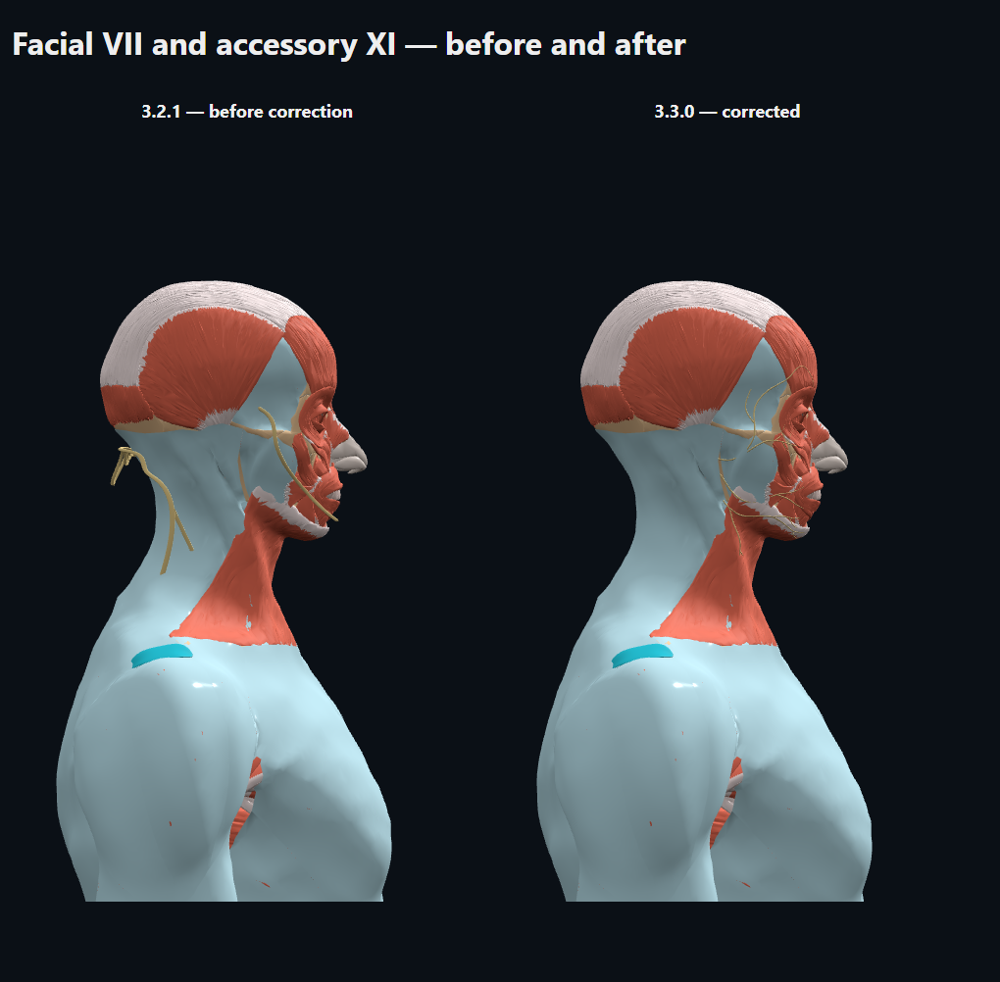
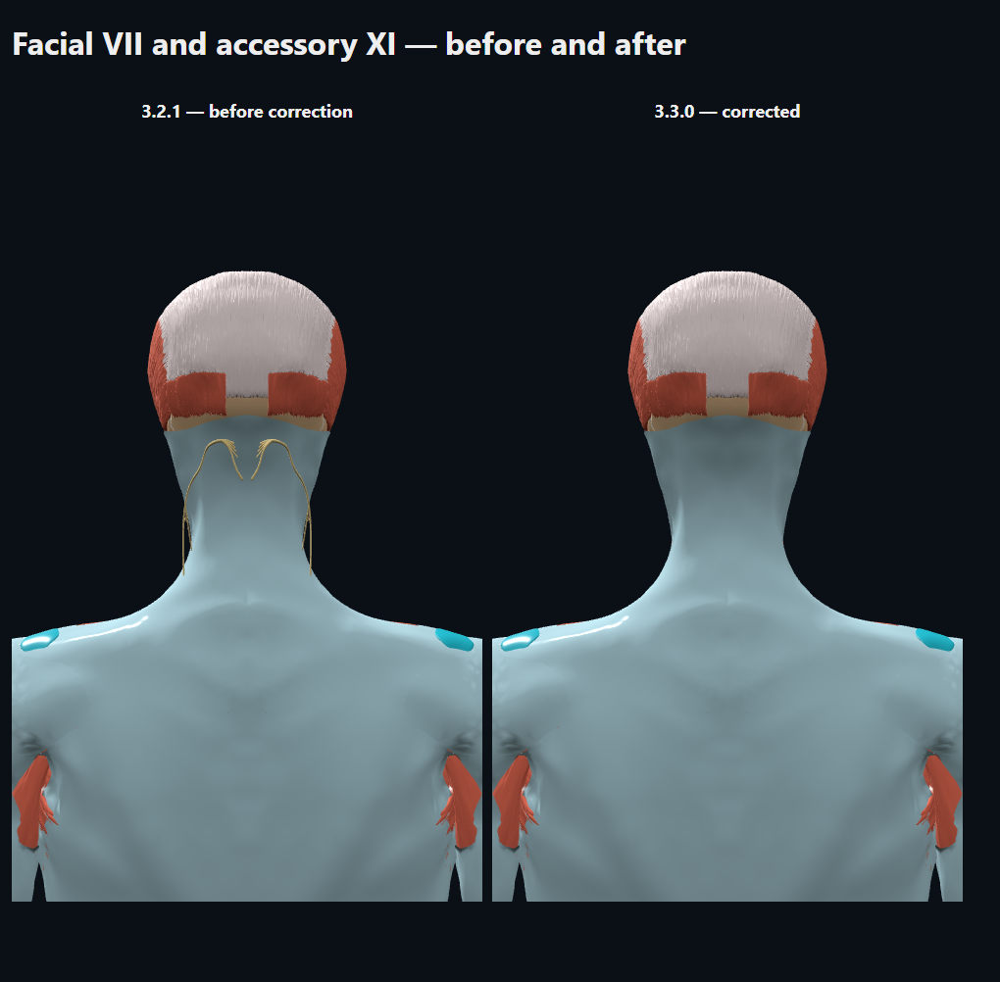

# Facial and accessory nerve placement — 3.3.0

The earlier importer matched the bounds of short DBCLS nerve trunks to the
larger legacy nerve extents. This distorted their proportions. Facial VII
also omitted five separately supplied branch components on each side.

VII now includes all six corresponding DBCLS 4.3 components in their shared
source coordinate frame. VII and XI use one uniform similarity transform,
fitted to six skeletal anchors: both temporal bones, the occipital bone,
mandible, atlas and axis. Trimmed closest-surface refinement preserves the
labels of these anchors. The fitted scale is 0.975281; median skeletal surface
distances range from approximately 0.40 to 1.27 mm. These are registration
residuals for the bones, not a clinical accuracy claim for every nerve point.

No independent per-axis or per-branch extent stretch is applied to these four
structures. Their source proportions and the connections between facial
branches are retained. XI represents the supplied DBCLS trunk; it is not an
invented reconstruction of every terminal branch in the larger legacy mesh.
The old uncertain cranial geometry has not been copied back.

See cranial-registration.json for the transform and source-anchor hashes, and
the model-provenance.json file for all actual nerve-component hashes.
The converter and registration tool are included in anatomy-source/tools.
The input cache is documented in FULL_ATLAS_INPUTS.md.

The before/after pictures render our independently licensed DBCLS adaptations
with the same body, camera and lights. They do not redistribute a rendering of
the uncertain legacy cranial contribution. BodyParts3D / DBCLS source data:
CC BY 4.0; this geometry adaptation: CC BY-SA 4.0. Full credits are in NOTICE.

